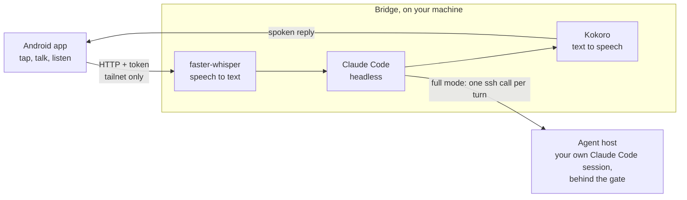

# Jarvis

Talk to Claude Code on your own machine from an Android phone, hands-free, over Tailscale.

## Why

Claude Code's Remote Control lets you continue a local session from the Claude app or a
browser, in text. `/voice` is dictation into the CLI on the machine that has the microphone; it
does not work over SSH and does not speak the reply. Neither gives you a spoken
back-and-forth from a phone. Jarvis does: you talk, your machine transcribes, Claude Code
works, and the phone speaks a short answer. There is no messaging platform and no hosted
speech service in between.

<!-- demo: GIF or video of a turn in the car, Mark records this -->

## How it works



The phone records a question and sends it to the bridge. The bridge transcribes it, runs
one Claude Code turn and speaks a short summary back, streamed sentence by sentence. The
session is resumed per project, so follow-up questions work.

There are two modes. In `readonly` (the default) the turn runs next to the bridge with
`Read`, `Glob` and `Grep` only. In `full` the turn runs on the *agent host*, the machine
where your own coding session lives, as that user and under its rules.

## What makes it different

- **A full agent with a gate.** In `full` mode a PreToolUse hook checks every tool call
  against rules kept as data in
  [`agent_host/gate_rules.toml`](agent_host/gate_rules.toml). Reads go through without a
  question. An irreversible action (a merge, a delete, a deploy, a copy to another host)
  is read back to you in one sentence and runs only after a spoken yes. Every tool call
  that can change something is logged.
- **Tailnet only, plus a token.** The bridge refuses to start on any address but a
  Tailscale one (loopback for tests; a private address only behind the Tailscale operator
  in a cluster), and every request needs a shared token. It is never public. The app accepts plain `http://` only for a `*.ts.net` name, where WireGuard
  already encrypts the traffic.
- **Speech stays on your machine.** Speech to text is faster-whisper and text to speech is
  Kokoro, both running locally. No audio goes to a hosted speech service. The model
  weights are downloaded once.

## Quickstart

You need a Linux machine on your tailnet with Claude Code 2.1.322 or newer (logged in),
[`uv`](https://docs.astral.sh/uv/), `espeak-ng` and about 2.5 GB of free memory, and an
Android 10+ phone with Tailscale.

1. **The bridge** ([`docs/how-to/bridge-service.md`](docs/how-to/bridge-service.md)):

   ```sh
   git clone https://github.com/MWest2020/jarvis && cd jarvis
   uv sync
   export JARVIS_BIND_HOST=$(tailscale ip -4)
   export JARVIS_TOKEN=$(openssl rand -hex 32)   # the phone needs this too; never commit it
   export JARVIS_PROJECTS=demo=/home/you/code/demo
   uv run jarvis-bridge
   ```

   This is `readonly` mode. The how-to lists every setting.

2. **The phone** ([`docs/how-to/android-app.md`](docs/how-to/android-app.md)): download
   the APK from the newest green run of the `android` workflow (Actions, artifact
   `jarvis-android-debug-apk`), install it, and enter the bridge address
   `http://<machine>.<tailnet>.ts.net:8787` and the token.

3. **Optional, `full` mode** ([`docs/how-to/agent-host.md`](docs/how-to/agent-host.md)):
   install the wrapper and the gate on the agent host with `sudo agent_host/install.sh`,
   add the one `authorized_keys` line it prints, and set `JARVIS_AGENT_MODE=full` with the
   ssh settings on the bridge. Read "What this trusts" in that how-to first.

## Status

Built and merged: the bridge in both modes, the gate with read-back and spoken yes, the
agent host installer, the Android app (sideloaded, built by CI), streamed replies, sending
a question after a few seconds of silence, sessions that end after an idle hour,
read-only helper subagents in a voice turn, and refused actions handed to the coding
session at the desk. `full` mode is live on the author's own setup.

Approved but not built yet: drive mode (where was I, nothing lost on a bad connection, a
drive log at the desk), notifications on the phone, confirming with a fingerprint, and a
speaker check. A Claude Code plugin is planned. See the
[roadmap](docs/reference/roadmap.yml) and the [docs index](docs/index.md).

## Built with

Specified with [OpenSpec](openspec/) and built largely by coding agents, with every change
reviewed.

## Related projects

- [VoiceMode](https://github.com/mbailey/voicemode): voice conversations with Claude Code
  through your computer's microphone and speakers, as an MCP server or a plugin; local Whisper and Kokoro or an
  OpenAI-compatible speech API.
- [Sidetone](https://github.com/crsmithdev/sidetone): a mobile voice interface for Claude
  Code; a bridge on your machine, a phone browser or Android app over WebRTC, local speech
  (faster-whisper on an NVIDIA GPU).

## License

No license yet: until one is chosen, all rights are reserved. The choice is open in
[#74](https://github.com/MWest2020/jarvis/issues/74).

## Support

If this is useful to you: [buy me a coffee](https://buymeacoffee.com/mark.westerweel).
